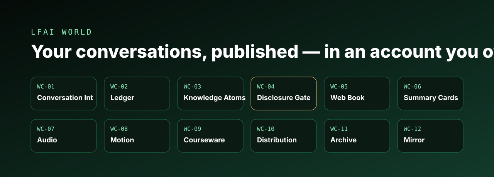
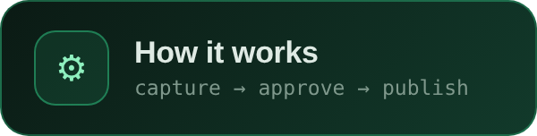
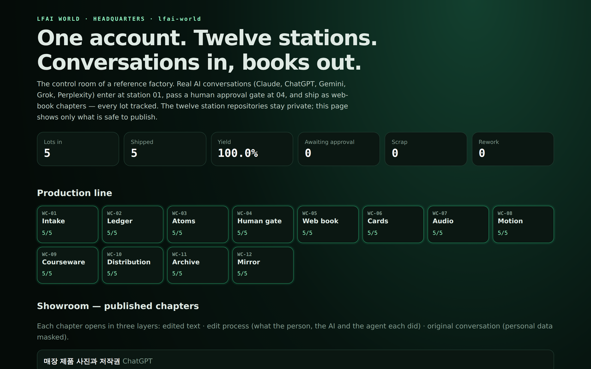
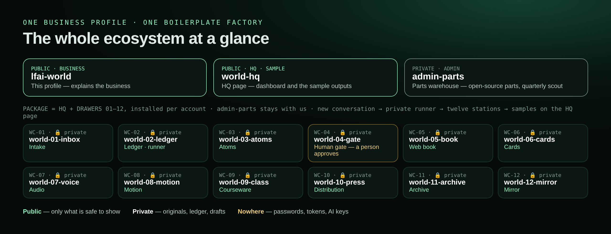
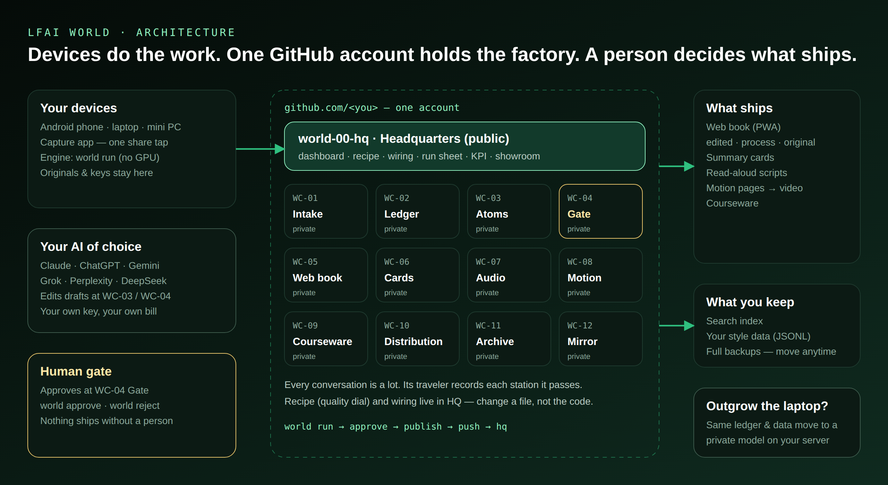
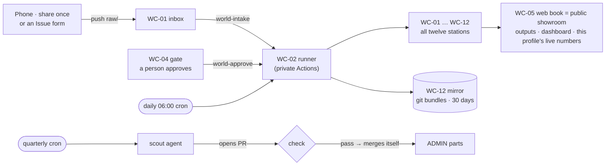

  
  
  
  

         

## Your AI conversations are your best raw material. Publish them from an account you own.

People who create knowledge every day — authors, lecturers, researchers, creators — already think out loud with AI assistants. Those conversations end up scattered across apps, cut off by clipboard limits, and stored on someone else's platform.

**LFAI WORLD is a personal publishing factory that lives inside one GitHub account.** A conversation goes in; a web book chapter, summary cards, an audio script, a motion page and courseware come out — after a person approves it. The owner keeps the originals, the keys and the data. No GPU, no hosted server, no lock-in to a single AI vendor.

The live dashboard of this account's reference factory — real numbers, refreshed from the owner's device.

## Watch it run (60 s)

**What the factory ships, per conversation:** a web-book chapter in three layers · cards (1080×1350) · narration (free edge TTS voice) · a vertical video · a lesson page — all published by drawer 05: **[the showroom](https://lfai-world.github.io/world-05-book/)** — searchable, with an [RSS feed](https://lfai-world.github.io/world-05-book/feed.xml). A customer's factory publishes the same way from their own drawer 05.

## The whole ecosystem at a glance

| # | Repository | Role | Visibility |
|---|---|---|---|
| — | [`lfai-world`](https://github.com/lfai-world/lfai-world) | **This profile — explains the business.** Everything below is the boilerplate factory installed per account | Public |
| HQ | `world-hq` | Control room — recipe, wiring, status, the private runner's home | Private |
| WC-01 | `world-01-inbox` | Intake — conversations arrive (share from phone or an Issue form) | Private |
| WC-02 | `world-02-ledger` | Ledger + cloud runner — de-duplicate, trace every lot | Private |
| WC-03 | `world-03-atoms` | Knowledge atoms | Private |
| WC-04 | `world-04-gate` | **Human gate** — personal-data scrub, a person approves | Private |
| WC-05 | [`world-05-book`](https://github.com/lfai-world/world-05-book) | **Web book = the public showroom.** Every drawer posts its results here; this drawer's publish gate puts them on the web — [lfai-world.github.io/world-05-book](https://lfai-world.github.io/world-05-book/) | Public |
| WC-06 … 10 | `cards` · `voice` · `motion` · `class` · `press` | Outputs — cards, audio, video, courseware, share kit | Private |
| WC-11 | `world-11-archive` | Archive — search index, the owner's style data | Private |
| WC-12 | `world-12-mirror` | Mirror — full git bundles on every run | Private |
| admin | `admin-parts` | Development only — parts warehouse, quarterly scout (not installed for customers) | Private |

## Live — refreshed by the factory, not by hand

<!-- LIVE:START -->
| | |
|---|---|
| Conversations in | **4** — ChatGPT, Claude |
| Shipped as web-book chapters | **4** — each with edited text, edit notes and the original |
| Yield | **100.0%** · awaiting approval 0 · scrap 0 · rework 0 |
| Stations passed | **4/4 lots · 12/12** |
| Wiring check | **14/14 lines** |
| Personal data left in published output | **0** (automated check) |
| Last refreshed | 2026-10-30 07:16 KST — by the factory itself, not by hand |
<!-- LIVE:END -->

## How it works

1. **Capture** — share a long conversation once from the phone. The capture app stores it without clipboard limits.
2. **Process** — `world run` cleans and de-duplicates it, splits it into knowledge atoms and masks personal data. Deterministic; runs on a laptop, a mini PC or an Android phone.
3. **Approve** — a person reads the queue and decides (`world approve`, `world reject` sends it back for rework).
4. **Publish** — approved material ships as a web book (PWA), cards, read-aloud scripts, motion pages and courseware.
5. **Measure** — every conversation is a *lot* with a traveler. `world kpi` reports yield, work-in-progress, scrap, rework and cycle time; `world runsheet` shows exactly where each lot is.
6. **Own** — `world backup` writes complete git bundles. The whole factory can be restored or moved.

## Nothing is hidden — the edit is part of the product

Each published chapter opens in three layers: the **edited text**, the **edit process** (what the person asked, what the AI answered, what the editing agent removed, corrected and added — and why), and the **original conversation** with only personal data masked. A bar shows how much of the chapter came from the person, the AI and the agent.

## The line in motion

## What it costs to run

| Part | Runs on | Monthly cost |
|---|---|---|
| Repositories, Issues, Pages, public Actions | GitHub Free | **0** |
| Private station runs | GitHub Free — 2,000 Actions minutes included; one full line run takes about 1–2 minutes | **0** |
| Private web book (optional) | GitHub Pro — adds Pages for private repositories and more minutes | **USD 4** |
| Engine | The owner's laptop, mini PC or Android phone — no GPU, no hosted server | **0** |
| AI | The assistant the owner already pays for — any vendor | **owner's own plan** |

No database, no VPS, no GPU. GitHub is the plant, the warehouse and the CDN; the owner's devices are the hands.

## GitHub as a factory — the playbook

**Learn it lesson by lesson:** [the Playbook — ten lessons, each tied to something running here](https://github.com/lfai-world/world-05-book/tree/main/playbook). Every change to the public side is itself an example: an instruction filed as an [issue](https://github.com/lfai-world/world-05-book/issues?q=is%3Aissue), worked as a [pull request](https://github.com/lfai-world/world-05-book/pulls?q=is%3Apr), merged on the owner's OK.

Most people use GitHub as a place to store code. This account uses it as **a zero-server production plant and a permanent database**, and every feature below is running here today. Each row is something a new owner learns during setup — by voice, through an agent, without memorising commands.

| GitHub feature | What it does in this factory | See it here |
|---|---|---|
| **Repositories** | Fifteen drawers, numbered in production order; private by default | [ecosystem map](#the-whole-ecosystem-at-a-glance) |
| **Actions — events** | A new conversation or an approval signals a private runner directly; it runs all twelve stations and refreshes the public pages. The public repositories hold no keys |  |
| **Actions — cron** | Daily 06:00 check run · quarterly parts scout (Jan · Apr · Jul · Oct) |  |
| **Pages + PWA** | Drawer 05 — the web book (installable like an app), every chapter's outputs and the factory dashboard, served free from the one public drawer | [sample site](https://lfai-world.github.io/world-05-book/) · [dashboard](https://lfai-world.github.io/world-05-book/factory/) |
| **Issues as a CMS** | An Issue form in the inbox becomes a conversation file and enters the line — no database | `world-01-inbox` · form “New conversation” |
| **Agent pull requests** | The scout agent opens a PR, a check validates it, then it merges itself | `admin-parts` · PRs |
| **Secrets + variables** | Wiring keys live in the owner's own Actions secrets — never in a file, never with us | repository settings |
| **Artifacts** | Every cloud run stores git bundles of all stations for 30 days | runner artifacts |
| **Endpoint badges** | The numbers above — including the nightly QA score — are JSON files the runner writes after each run | [badges/](https://lfai-world.github.io/world-05-book/badges/yield.json) |
| **REST / GraphQL API** | The installer and the agent drive all of this — one command, `world apply`, then `world wire` | installer |

## Why this is different

| | Platform-owned AI | Local note apps | **LFAI WORLD** |
|---|---|---|---|
| Who owns the source | The platform | The user | **The user — device + own account** |
| Publishing | Inside the platform | Often a paid add-on | **Web book included** |
| AI model | The vendor's own | Plugins | **Your choice, your bill** |
| Hardware | Vendor servers | Your device | **Laptop / mini PC / phone, no GPU** |
| Process visibility | None | None | **Every lot traced; every edit shown** |
| Leaving | Hard | Files only | **The whole factory moves** |

## Principles
- **Keys and originals stay with the owner.** Tokens, passwords and AI keys are never stored by the factory or by us.
- **A person approves every publication.** The gate is a design choice, not a setting.
- **Standard model.** One installer (the bolt) and a fixed menu of options (the nuts) — no per-client custom code.
- **Honest output.** AI text is raw material; the edit and its reasons are published alongside it.

## Business model
- **Turnkey setup, one person at a time** — account, devices, capture app, engine and a first published chapter, verified on site against five acceptance checks. Fixed scope, fixed follow-up Q&A, no open-ended support.
- **Upgrade path** — when an owner's archive justifies a private model on dedicated hardware, the same ledger and style data carry over. Nothing is rebuilt.

LFAI WORLD · Life First, AI Second · Not affiliated with the LF AI & Data Foundation.
